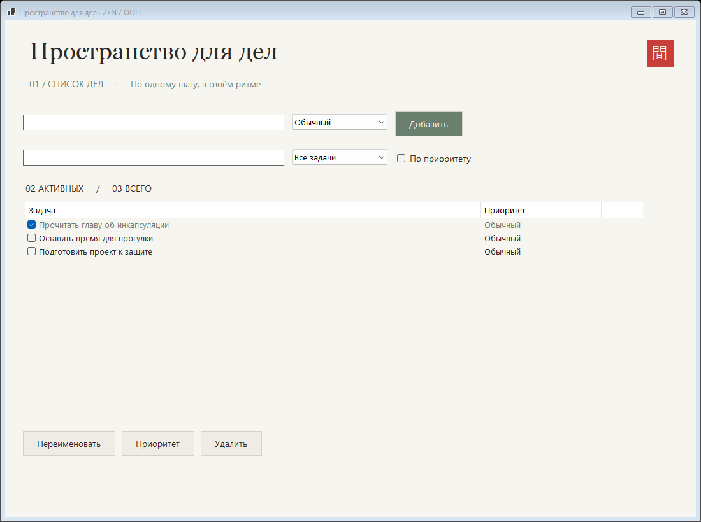

# Список дел

Автор: Ли Анастасия

## Запуск

Windows + .NET 8 SDK. Из корня репозитория:

```powershell
dotnet run --project lab1-todo/Todo.csproj
```



## Управление и устройство

1. Введите название, выберите приоритет и нажмите «Добавить» или Enter.
2. Флажок отмечает выполнение; выделение строки позволяет переименовать и удалить задачу.
3. Кнопка «Приоритет» применяет выбранный сверху приоритет к выделенной задаче.
4. Поиск работает по мере ввода; фильтр и сортировка сочетаются.

JSON сохраняется после изменения в `%LOCALAPPDATA%/ZenOop/tasks.json`. Отсутствующий файл означает пустой список. Ошибка загрузки отображается, исходный файл автоматически не перезаписывается.

`TodoItem` инкапсулирует ID, название, выполнение и `Priority`; `TodoList` управляет коллекцией, поиском, фильтрацией, сортировкой и сохранением. `MainForm` только связывает элементы окна и модель. Ненужного наследования у простых задач нет.

- [x] Модель с закрытым состоянием и валидацией.
- [x] Окно с дополнительным полем приоритета.
- [x] Выполнение, переименование, удаление.
- [x] Ошибки пустого названия, отсутствия выбора и неверного приоритета.
- [x] JSON и восстановление при запуске.
- [x] README и скриншот.
- [x] * Фильтры и сортировка методами модели.
- [x] ** Живой поиск и цвет высокого приоритета.
